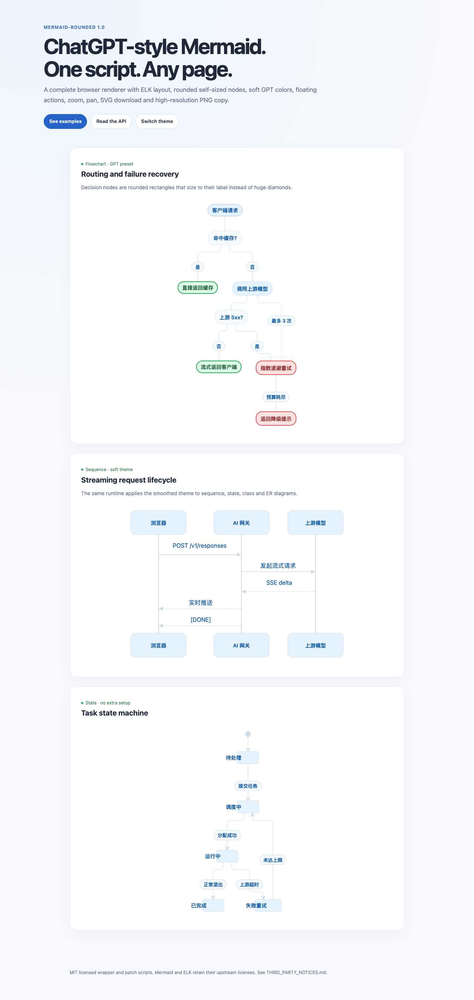

# gpt-mermaid

[](https://github.com/edwardwonggang/gpt-mermaid/actions/workflows/ci.yml)
[](./LICENSE)
[](https://mermaid.js.org/)

**ChatGPT-style Mermaid for any HTML page.**

`gpt-mermaid` is a complete browser renderer and UI layer for Mermaid. It combines a patched Mermaid 12.3.0 runtime with ELK flowchart layout, rounded self-sized nodes, direction-colored connectors, tall filled triangle arrows, a floating action menu, zoom/pan, fullscreen viewing, SVG download and high-resolution PNG copy.

The default preset is **GPT**. The UMD build exposes the browser global `GPTMermaid`.

> **Not affiliated with OpenAI or the Mermaid project.** “ChatGPT-style” only describes the visual presentation. See [NOTICE.md](./NOTICE.md).



## Why

Plain Mermaid is powerful, but its default flowchart decisions are large diamonds and its labels are often constrained by a fixed wrapping width. `gpt-mermaid` changes the shape pipeline and adds a complete presentation layer:

- decision diamonds become rounded rectangles that grow with their text;
- ordinary rectangles get a consistent radius and tighter padding;
- ELK layered layout is used for complex diagrams;
- the `gpt` preset uses blue nodes, stronger borders and distinct connector colors for right, down, left and up directions;
- directional arrows share a 10:8 height-to-base ratio (height is measured along the arrow direction); their tips meet actual node contours. ER cardinalities, UML diamonds and lollipops retain their native shapes;
- the inline viewer has no permanent gray toolbar;
- hover the diagram to reveal the `⋯` menu and fullscreen button;
- copy source, copy a high-resolution PNG, download SVG, zoom, pan and open fullscreen.
- scroll normally to zoom in the fullscreen viewer; inline diagrams use `Ctrl + wheel` so ordinary scrolling keeps moving the page.
- 手机点开全屏后，双指缩放、单指平移整张图；行内滑动仍用于页面阅读。触屏按钮支持点击复位与关闭，不依赖鼠标或键盘。
- 长链和连续分支组支持自动“贪吃蛇”折返；边标签贴合连线，拥挤端口、自环和 C4 可读性统一校准。
- frontmatter 只在文档首部生效；图种分类会跳过 YAML 块，安全过滤仅保留 `title` 与 `displayMode`。
- 渲染队列支持 `AbortSignal`、渲染超时和运行时加载超时；长图在行内使用独立滚动视口，不把整页无限撑高。

兼容性页面位于 `demo/compatibility.html`：101 个去重样例、22 种图表，提供自动折返与原布局对照。复杂反馈、跨层边和嵌套子图保留原布局，页面会显示原因。

## Quick start

```html
<link rel="stylesheet" href="./dist/gpt-mermaid.css">
<script src="./dist/gpt-mermaid.umd.js"></script>

<pre><code class="language-mermaid">
flowchart TD
  A(["客户端请求"]) --> B{"命中缓存?"}
  B -->|"是"| C(["直接返回"])
  B -->|"否"| D["调用上游模型"]
</code></pre>

<script>
  GPTMermaid.configure({ preset: "gpt" });
  GPTMermaid.renderAll();
</script>
```

`gpt-mermaid.umd.js` lazily loads `gpt-mermaid.runtime.min.js` from the same directory. The CSS is also injected automatically, so the `<link>` is optional but recommended for first-paint stability.

### CDN

```html
<link rel="stylesheet" href="https://cdn.jsdelivr.net/gh/edwardwonggang/gpt-mermaid@main/dist/gpt-mermaid.css">
<script src="https://cdn.jsdelivr.net/gh/edwardwonggang/gpt-mermaid@main/dist/gpt-mermaid.umd.js"></script>
<script>
  GPTMermaid.renderAll();
</script>
```

For production pin a release tag or commit instead of `main`.

## ESM / npm

```bash
npm install gpt-mermaid
```

```js
import GPTMermaid, { renderAll, renderSvg } from "gpt-mermaid";
import "gpt-mermaid/css";

GPTMermaid.configure({ preset: "gpt" });
await renderAll(document);

const result = await renderSvg("flowchart LR\nA --> B");
console.log(result.svg, result.width, result.height);
```

When a bundler rewrites `import.meta.url` or does not copy `dist/gpt-mermaid.runtime.min.js`, set the runtime URL explicitly:

```js
GPTMermaid.configure({
  runtimeUrl: "/assets/gpt-mermaid.runtime.min.js"
});
```

Copy `node_modules/gpt-mermaid/dist/gpt-mermaid.runtime.min.js` to that public
path with the bundler's static asset step.

## API

| Method | Description |
| --- | --- |
| `configure(options)` | Merge global options and return the effective config. |
| `renderSvg(source, options)` | 返回 `{ svg, width, height, source, routing }`，不挂载界面。 |
| `mount(target, source, options)` | Mount a diagram into an element or selector. |
| `render(source, options)` | Mount into `options.target`, or append a new figure to `body`. |
| `renderAll(root, options)` | Render all `pre > code.language-mermaid` and `[data-gpt-mermaid-source]` nodes. |
| `autoRender(options)` | Run `renderAll` after DOMContentLoaded when needed. |
| `destroy(diagram)` | Release the blob URL, observers and DOM of a mounted diagram. |
| `sanitizeSource(source)` | Validate and sanitize Mermaid source before rendering. |
| `sanitizeSvg(svg)` | Apply the built-in SVG allowlist. |

所有渲染入口都接受 `signal?: AbortSignal`。`renderTimeoutMs` 默认 `12000` 毫秒，
`runtimeTimeoutMs` 默认 `15000` 毫秒；超时或中止会以 `TimeoutError` / `AbortError`
结束等待，并释放串行队列。底层第三方任务若不响应中止信号，仍可能自行完成，但不会永久占住后续渲染。

```js
const controller = new AbortController();
const result = await GPTMermaid.renderSvg(source, {
  signal: controller.signal,
  renderTimeoutMs: 12000,
  runtimeTimeoutMs: 15000
});
```

### 连线交叉检测与自动避障

流程图、状态图、类图、ER 和 C4 的连线在最终 SVG 上检测交叉。算法优先保留正常路径，
对有明确端点身份的冲突边尝试避开节点、其它连线、箭头和标签；再尝试整组通道调整及有限间距扩张。
文字和节点本身不缩放，连接关系不改变。共享汇入仅豁免连续重合的目标末段。

```js
const result = await GPTMermaid.renderSvg(source);
console.log(result.routing);
// { status, checkedEdges, crossings, crossingsBefore, spacingFactor, reason }
```

`status` 为 `clear`（已检查的关系线未发现交叉）、`unresolved`（仍有残留）或
`not-applicable`（该图没有本检测器支持的关系线）。`crossings` 按相交边对计数。
`reason` 区分 `fixed-obstacles`、`search-budget` 和 `non-planar-edge-bound`。
渲染成功不表示没有交叉，兼容页会独立显示这项结果。

自动避障有确定的计算上限，不保证任意输入都能零交叉。含簇/组合节点和非三角语义端点的图
不会直接按轴扩间距；可平面关系可尝试基于结构的外围环/重心布局，并在新切线方向保留特殊端点偏移。
该候选还必须通过实际节点框、标签和交叉验收。过密关系的拓扑可能本身不能在平面无交叉表示，
此时保留关系并报告残留，不能靠删除边或隐藏交点假报通过。当前样例范围见 `docs/rendering-verification.md`。

### Direct container

```html
<div id="diagram"></div>
<script>
  GPTMermaid.mount("#diagram", "graph LR\nA --> B");
</script>
```

### Auto-render attributes

```html
<div data-gpt-mermaid-source>
flowchart LR
  A --> B
</div>
<script>
  GPTMermaid.renderAll();
</script>
```

## Configuration

```js
GPTMermaid.configure({
  preset: "gpt",           // gpt | github | linear | tokyo | nord
  fontFamily: '"PingFang SC", sans-serif',
  runtimeUrl: "./vendor/mermaid/gpt-mermaid.runtime.min.js",
  autoInjectStyles: true,
  maxInlineWidth: 740,
  fitMaxHeight: Infinity,
  adaptiveLayout: { enabled: true, maxWidth: 1200, maxHeight: 1000, gap: 80 },
  themeVariables: {
    primaryColor: "#e5f3ff"
  }
});
```

The `themeVariables` object is merged after the preset, so one-off adjustments are safe.

## Security

- Mermaid is initialized with `securityLevel: "strict"`.
- Frontmatter 只允许 `title` 和 `displayMode`；其中的 `config`、flow-style 配置、非法 JSON 和未允许键会被丢弃。YAML 块标量里的缩进 `---` 不会被误当成 frontmatter 闭合。
- `click` 指令、`securityLevel` 覆盖和不允许的 `%%{init}%%` 配置会被移除；只保留受限的安全颜色和 `themeCSS`。
- Rendered SVG is passed through an allowlist sanitizer. Scripts, event handlers, `foreignObject`, `ping`, `srcset`, external `url(...)`, unsafe `href`/`src` and namespaced XLink attributes are removed; local fragment `xlink:href` remains supported.
- SVG `<style>` 会按根节点安全 ID 作用域化；全局 at-rule、`@import`、`expression()`、`-moz-binding`、不受信任的 `url(...)` 会被丢弃。
- No remote resources are required at runtime.
- The package is browser-first; it does not render on the server and does not execute untrusted HTML.

See [SECURITY.md](./SECURITY.md) for the reporting process.

## npm publishing

The package name `gpt-mermaid` is intended to be published as a public
unscoped npm package. Publishing requires an authenticated npm account and
2FA/OTP when enabled on the account. Licensing details are in
[THIRD_PARTY_NOTICES.md](./THIRD_PARTY_NOTICES.md) and
[LICENSES/README.md](./LICENSES/README.md).

## Development

```bash
npm install
npm run build       # generates dist UMD/ESM/CJS bundles
npm run check       # syntax checks
npm test            # unit/security/render tests
npm run test:api    # package exports and ESM/CJS entrypoints
npm run test:api-types
npm run test:e2e    # Playwright smoke test
npm run test:all
```

`npm run build:runtime` regenerates the patched Mermaid runtime from the official 12.3.0 package. The anchor assertions in `scripts/apply-patch.mjs` fail loudly if Mermaid changes.

CI separates unit/API, Chromium, WebKit and package jobs. It checks that rebuilding leaves
`dist/` unchanged, pins the Mermaid runtime checksum, runs API declaration consumers,
generates and installs an npm tarball, and verifies ESM/CJS/UMD entrypoints. Existing
`node:test` files outside the `*.test.mjs` glob are discovered explicitly, and new test
scripts that are not wired into CI fail the coverage check.

## Compatibility

- Mermaid runtime: 12.3.0, bundled as `dist/gpt-mermaid.runtime.min.js`.
- Browsers: modern Chromium and WebKit 26.5 mobile emulation have passing reports; WebKit touch coverage uses synthetic PointerEvent state tests, so Safari native multi-touch and physical iPhone remain unverified. Firefox is not tested.
- The wrapper itself has no framework dependency.
- Open [`demo/compatibility.html`](./demo/compatibility.html) to inspect simple-to-complex examples across common diagram types, including expected error fallback.
- The legacy patch scripts and old demos remain available under [docs/legacy-patch.md](./docs/legacy-patch.md) and `demo/legacy.html`.

Chromium 原生触摸输入和 WebKit 合成触屏状态机报告均为 14 项；WebKit 报告不替代
Safari 原生多指或物理 iPhone 验证。

## Project layout

```text
src/                 modular wrapper source
dist/                published UMD/ESM/CJS/CSS and Mermaid runtime
docs/                API, architecture and patch history
demo/                browser demos and screenshots
scripts/             build, static server and runtime patch
test/                Node and Playwright tests
.github/workflows/   CI
```

## License

The wrapper, build scripts and demos are MIT licensed. `dist/gpt-mermaid.runtime.min.js` is a derivative of Mermaid 12.3.0 (MIT) and includes ELK (EPL-2.0) components. See [LICENSE](./LICENSE) and [THIRD_PARTY_NOTICES.md](./THIRD_PARTY_NOTICES.md).
